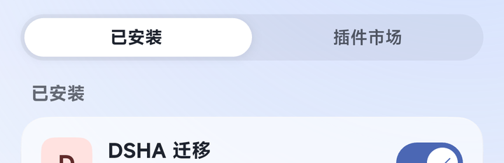
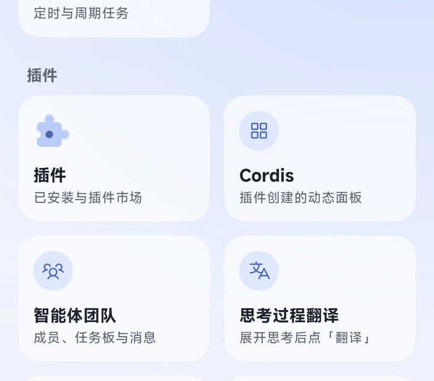
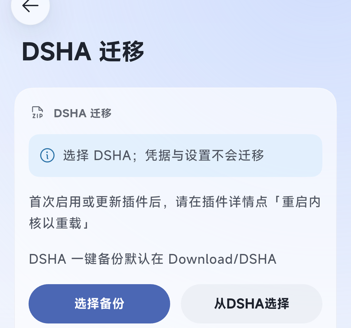
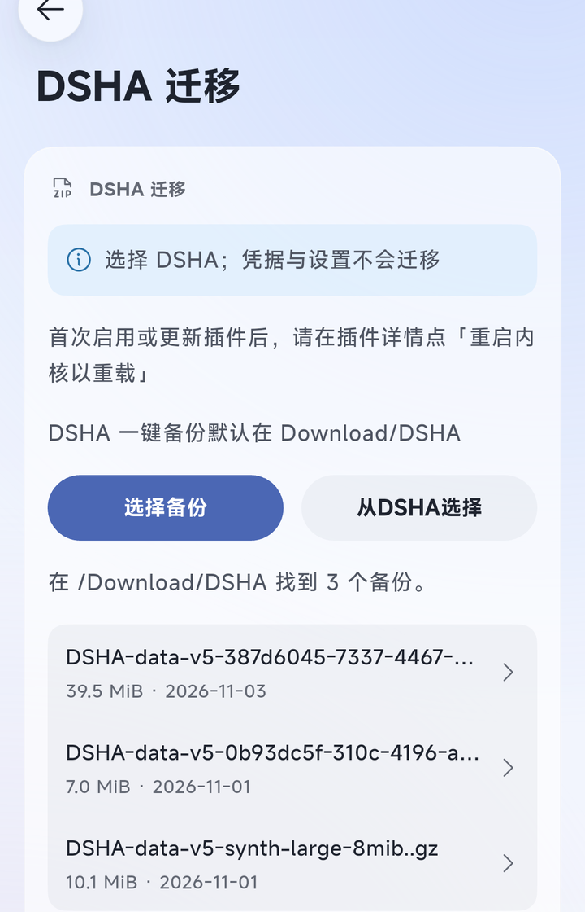
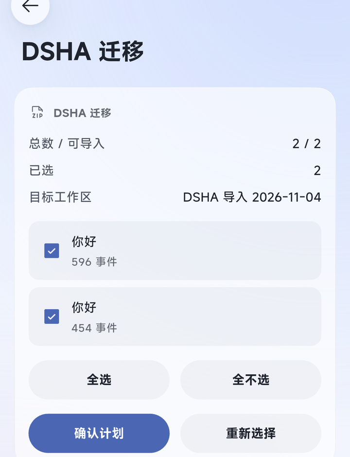
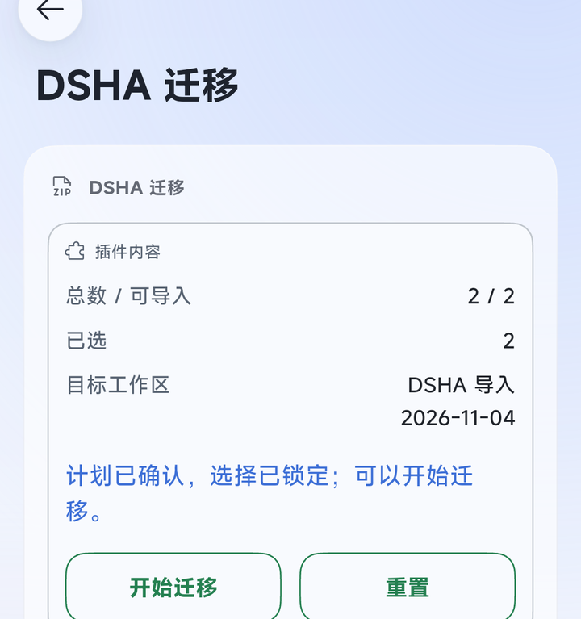
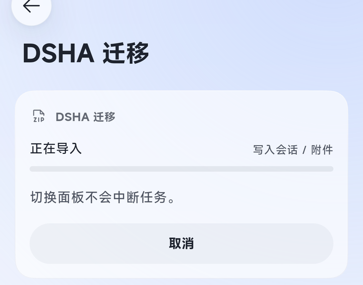
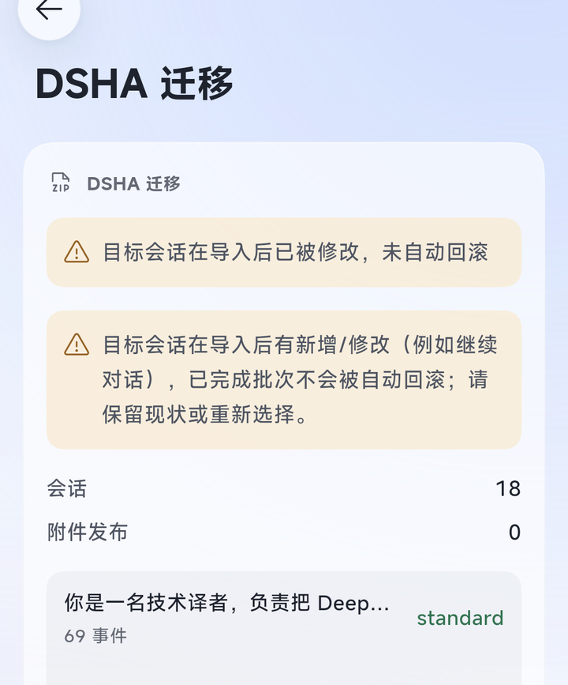

# DSHA → dsh-Go migration

Move sessions from a **DSHA** one-click backup into **dsh-Go** and keep chatting: messages, tool history, preset and timeline are preserved.

Everything runs on the phone — no computer, no root, no uploading chat data.

**First time here?** Follow the user guide below; for implementation and verification status jump to [Status](#status).

## User guide

Every step below has a real-device screenshot (Redmi, dsh-Go 1.0.7 + plugin 0.1.4).

### 1. Prepare

1. Install **dsh-Go** (App `1.0.4`+) and **DSHA** on the phone.
2. Make a one-click backup in DSHA; it lands in `Download/DSHA`.
3. Turn on “访问手机文件” in dsh-Go's `Settings` so the plugin can read the backup (toggling it restarts the engine once).

### 2. Install and enable

1. `Settings › Plugins › Plugin market`, search `dsha-to-dshgo` (shown as “DSHA migration”), tap “Install to…”.
2. When the App asks, restart the engine (“Engine restart needed”, or “Restart now” in the snackbar).
3. In `Settings › Plugins › Installed`, make sure the plugin is enabled. Restart the engine once after every update.



### 3. Open the panel

`All features` → the “插件” group → the “DSHA 迁移” card (subtitled “插件面板”):



The migration panel opens on its first screen:



Two ways in:

- **Choose from DSHA** (recommended) — scans `Download/DSHA` and lists the backups; pick one. DSHA backups are usually large, so this is the easy path.
- **Choose backup** — system file picker; pick one file by hand, fine for small backups.

### 4. Pick a backup

After “Choose from DSHA” the panel lists the backups it found, each with size and date; tap one to migrate it:



The panel then copies the backup and verifies it: the whole archive is read once (archive, session history, attachments). **Large backups take a while — don't close the App.**

### 5. Pick the sessions to import

The session list appears after verification, all selected by default:



- One row per session: title + event count.
- “Select all / Clear all” for bulk changes; more than 8 sessions are paginated (“Previous / Next”) and selection survives paging.
- The header shows “total / importable”, “selected”, and the target workspace (named `DSHA 导入 date`).
- Sessions that cannot be imported are listed with a reason — just leave them unselected.

Presets carry over automatically: a preset installed on the phone is reused, otherwise the default one is used. Tap “Approve plan” when ready.

### 6. Approve → start

After “Approve plan” the panel says the plan is confirmed and the selection locked, with “Start import” and “Reset”:



Tap “Start import” and the panel shows “Importing / writing sessions, attachments”:



- Leaving the panel does not interrupt the job.
- “Cancel” stops the batch and rolls back what it created — nothing is left half-written.
- “Reset” only returns to the first screen; it does not undo an approved plan. To abandon, use another backup or target.

### 7. Done → restart → keep chatting

The job ends on the result page: the outcome on top, the written sessions and their presets below.



After “Import complete”:

1. Restart the engine (engine page → restart, or the restart entry in Settings).
2. Open `All features › Workspaces` (or the workspace switcher in the drawer) and find `DSHA 导入 date`.
3. Open a session and continue — history and preset are intact.

On the result page, “New migration” starts the next batch; “Delete this task's private data” only removes this task's temporary data and never touches imported sessions.

> The result screenshot above is a **repeat import**: the same backup had been migrated before and continued afterwards, so it reports “Target sessions changed after import; automatic rollback was not attempted”. A first-time import shows “Import complete”.

### 8. Common messages

| Message | What to do |
|---|---|
| Cannot read the phone download directory | Turn on “访问手机文件” in `Settings` |
| The selected download file is no longer available; scan again | The backup was moved or deleted — scan again |
| Could not stage a private copy | Check free storage, or scan again |
| A referenced attachment object is missing from the backup | The backup is incomplete — make a new one in DSHA |
| The session already belongs to another workspace | One session cannot be imported twice; skip it |
| This backup was imported before | Repeat imports are recognised; the target is re-checked, nothing is written twice |
| “Failed” with no importable sessions | Configure an Agent preset in the App, restart the engine and retry |
| The target still has an import lock | Restart the engine and retry; if it persists use the panel's recovery entry |

For the full per-status reference, recovery flow and known issues, see [docs/troubleshooting.md](https://github.com/384615666/dsha-to-dshgo/blob/HEAD/docs/troubleshooting.md) (Chinese).

### 9. Data and safety

- The backup is parsed and written on the device only; nothing is uploaded, and credentials are never migrated.
- Imports go into a new `DSHA 导入 date` workspace and never touch your own workspaces; a session never belongs to two workspaces.
- Uninstalling the plugin does not affect imported sessions.
- Don't treat this version as the only copy of your data — open one imported session and confirm it continues.

## Status

Current version `0.1.4` (npm `dsha-to-dshgo`). Implemented and verified against an isolated rc.4 engine with a real backup:

- **Input**: DSHA v5 backup (gzip magic, accepts `..gz`); scan the phone's `Download/DSHA` and stream it into the private job, so large backups are supported without loading the whole file.
- **Parsing/restore**: full archive verification, allowlisted staging, official historical chain (v0–v3 → v4), parent/child catalog binding, official `locate()` location verification; unavailable/ambiguous/non-canonical generations are isolated and reported instead of silently falling back.
- **A-path write**: official `create/append/flush/close` plus full semantic readback; source session IDs preserved.
- **Attachments**: published before sessions (images byte-for-byte, files verbatim), official readback before create; created objects are quarantined (never deleted) on rollback, shared objects stay.
- **Safety**: G6 workspace-unit snapshot, approved-plan content gate, durable journal, protected withdrawal rollback, user edits/additions/new references preserved as pending; stale crash locks/guards are inspectable and explicitly releasable from the recovery panel.
- **Privacy**: task-private data under `$DSH_HOME/dsha-migrator/`, files 0600/directories 0700; explicit task-data deletion; diagnostics stay in the private data directory.
- **Native panel**: pick backup → copy/verify progress → paginated session selection → automatic preset/cwd mapping → approve plan → start/cancel → result and recovery.
- **Repeat import**: the same backup re-verifies the target; identical content reports done, a changed target is reported as modified instead of silently appended.

Baseline: 208 automated tests with the isolated engine and real fixtures; SDK manifest/half-host load/zh-en panels pass; the npm package gate passes. Historical generations (v0–v3) have synthetic fixtures only — **not validated against real user legacy data**.

**Release note**: the npm package is `dsha-to-dshgo`; official market indexing may lag—install from npm if the market has not refreshed yet. Real continuation passed on the available `Glm 5.3 Flash` channel (an empty control, plus the imported session before and after restart); the imported session's original `Flash` channel still needs a DeepSeek API key. B path remains an experimental entry and is not wired into the job. Native list, workspace filter, titles, restart and history reopening pass on the Redmi. Do not use this version as the only copy of your data.

## Development install (no root)

```sh
# desktop web profile
dsh plugin --profile web add /path/to/dsh-dsha-migrator

# on-device engine (run in the App terminal; copy the plugin folder to phone storage first)
cp -r /sdcard/Download/dsh-dsha-migrator /root/.dsh/dsh-go/plugins/
dsh plugin --profile web add /root/.dsh/dsh-go/plugins/dsh-dsha-migrator
# then restart the kernel from the App engine page
```

Plugins installed from a local directory get an extra “Restart engine to reload” row in `Settings › Plugins › Installed › DSHA migration`; tap it after editing `lib/` (running tasks are interrupted).

## Data and privacy

- Job data lives under `<DSH_HOME>/dsha-migrator/` (journal, frozen plan, content-addressed snapshot, quarantine).
- A successful job removes the private input copy and candidate staging; journal/snapshot stay as the recovery point until the user explicitly deletes the task data.
- Failure/cancel compensates through G6 and protected withdrawal; undecidable objects stay pending with minimal evidence.
- Uninstalling the plugin does not affect imported sessions.

## Compatibility

- Target engine: `>=0.2.1-rc.4 <0.3.0-0` (evidence baseline rc.4); App `minApp 1.0.4` (1.0.7 tested).
- Input: DSHA one-click backup v5; session formats v0–v4 are upgraded to v4 by the target's official chain.

## License

[MIT](./LICENSE)
