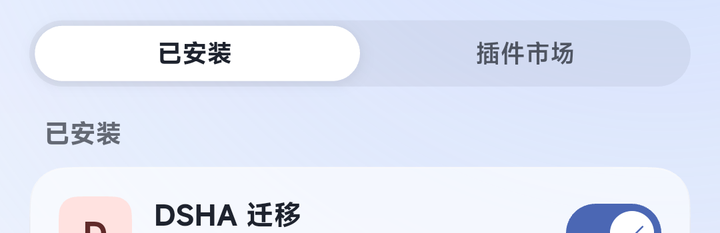
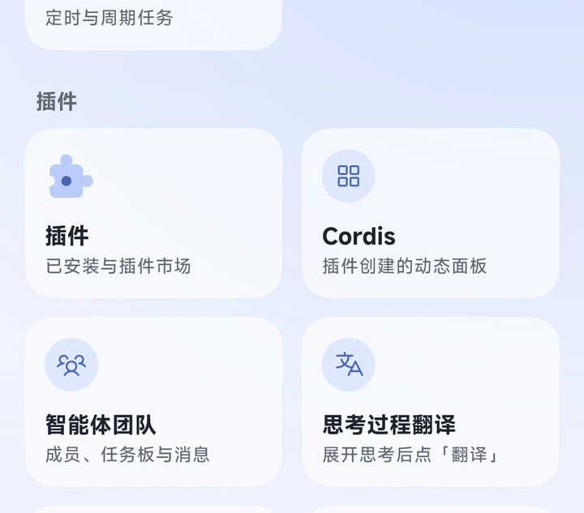
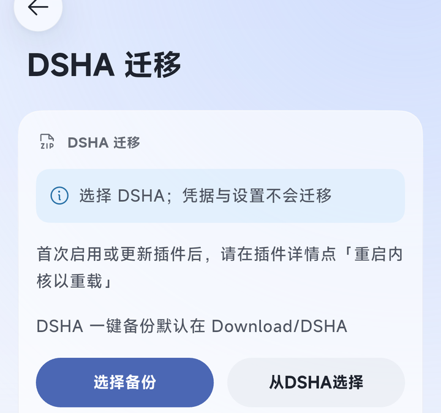
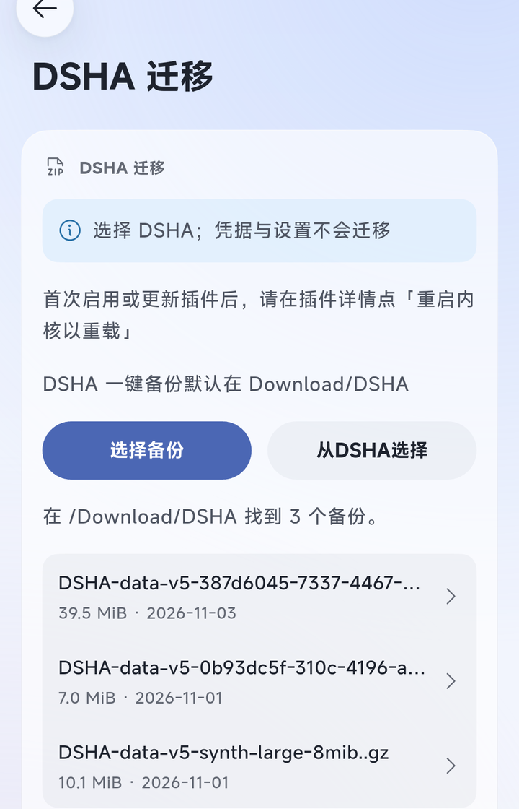
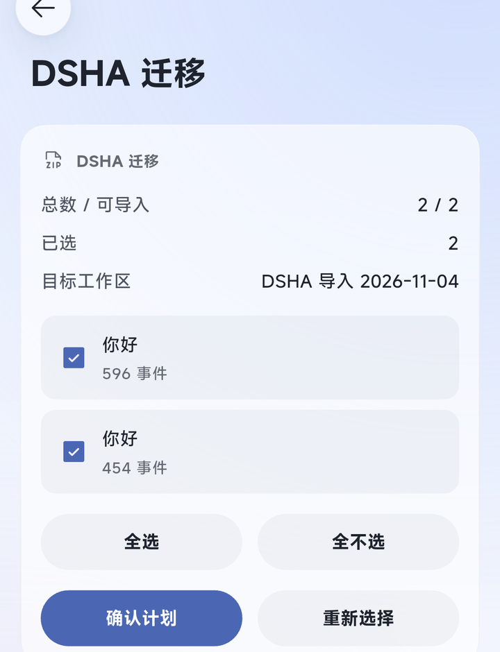
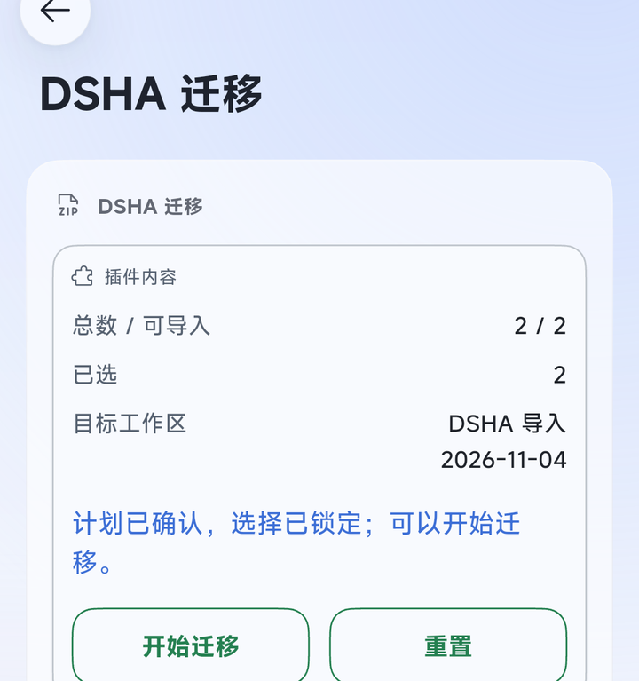
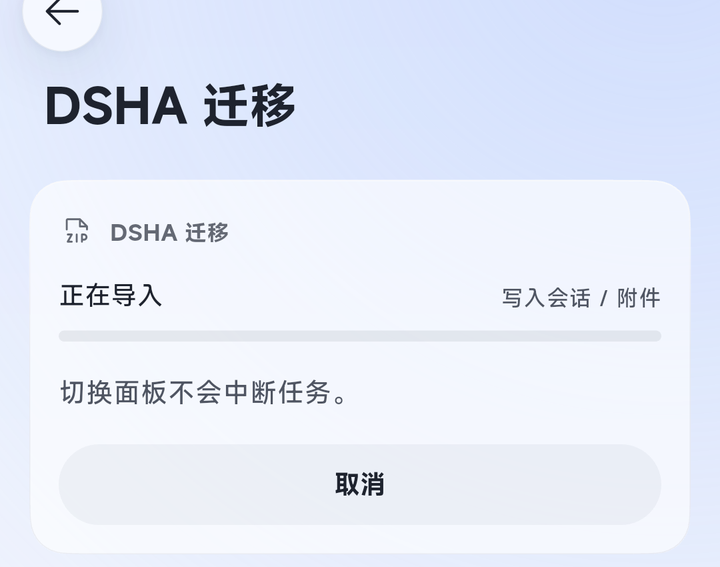
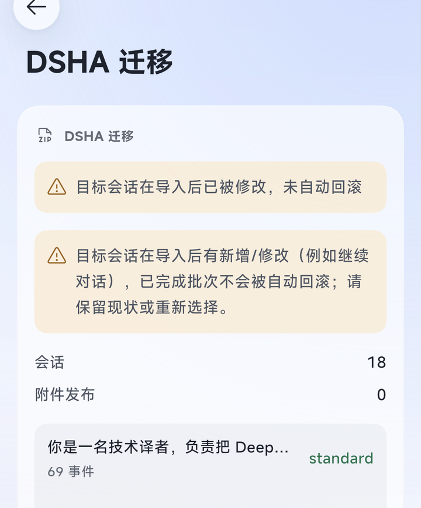

# DSHA 迁移 / dsha-to-dshgo

[中文](#中文) | [English](#english)

---

## 中文

把 **DSHA**（DeepSeek Harness Android 端）「一键备份」里的会话搬到 **dsh-Go**，导入后能接着聊。正文、工具历史、preset 和时间线都保留。

全程在手机上完成：不需要电脑、不需要 Root、不联网上传聊天数据。

**第一次使用**：照下面的[操作手册](#操作手册)走一遍即可；想看实现细节和验证情况，跳到[当前状态](#当前状态)。

### 操作手册

下面每一步都配了真机截图（Redmi，dsh-Go 1.0.7 + 插件 0.1.4）。

#### 一、准备

1. 手机上装好 **dsh-Go**（App `1.0.4` 以上）和 **DSHA**。
2. 在 DSHA 里做一次「一键备份」。备份文件默认保存在 `Download/DSHA`。
3. 在 dsh-Go 的 `设置` 里打开「访问手机文件」，让插件能读到备份（开关它会让引擎重启一次）。

#### 二、安装并启用

1. `设置 › 插件 › 插件市场`，搜 `dsha-to-dshgo`（名字显示为「DSHA 迁移」），点下面的「安装到…」。
2. 装好后按 App 的提示重启引擎（弹窗「需要重启引擎」，或提示条里的「立即重启」）。
3. 到 `设置 › 插件 › 已安装` 确认「DSHA 迁移」是启用状态。以后每次更新插件，都重启一次引擎。



#### 三、打开面板

入口在 `全部功能` 的「插件」分组里，卡片叫「DSHA 迁移」，副标题是「插件面板」：



点进去就是迁移面板：



面板上有两个入口：

- **从DSHA选择**（推荐）：自动扫描 `Download/DSHA`，列出找到的备份，点一个就开始。DSHA 的备份通常比较大，走这条最省事。
- **选择备份**：打开系统文件选择器，手动挑一个备份文件，适合小备份。

#### 四、选择备份

点「从DSHA选择」后，面板会列出手机里找到的备份，每条带大小和日期，点哪条就迁哪条：



选好之后面板先「复制备份」、再「校验备份」：把备份完整读一遍，检查归档、会话历史和附件。**大备份要等一会儿，这期间别关 App。**

#### 五、选择要导入的会话

校验完成后出现会话列表，默认全部勾选：



- 每条是一个会话：标题 + 事件数。
- 「全选 / 全不选」批量调整；超过 8 条用「上一页 / 下一页」翻页，翻页不会丢已选。
- 顶部能看到「总数 / 可导入」「已选」和导入后要去的目标工作区（叫 `DSHA 导入 日期`）。
- 不能导入的会话会单独列出原因，不勾它就行。

原来的 preset 会自动沿用：手机上有同名 preset 就用它，没有就用默认的，不用手动选。确认没问题，点「确认计划」。

#### 六、确认计划 → 开始迁移

点「确认计划」后，提示「计划已确认，选择已锁定」，按钮变成「开始迁移」和「重置」：



点「开始迁移」，面板显示「正在导入 / 写入会话、附件」：



- 迁移中切到别的页面没关系，任务不会中断。
- 想中途停就点「取消」，本批已经建的东西会回滚，不会留一半。
- 「重置」只是回到首页，不会撤销已经确认的计划。确认之后想放弃，换一份备份或换个目标重来。

#### 七、完成 → 重启 → 继续聊

迁移结束会停在结果页：上面是结果提示，下面是这次写入的会话和它们用的 preset。



看到「导入完成」后：

1. 重启一次引擎（引擎页的「重启引擎」，或设置里的重启入口）。
2. 到 `全部功能 › 工作区`（或抽屉里的工作区切换）找名为 `DSHA 导入 日期` 的工作区。
3. 点开会话就能接着聊，历史、preset 都在。

结果页里：「新的迁移」开始下一批；「删除本任务私有数据」只清这次任务留下的临时数据，已经导入的会话不受影响。

> 上面这张结果图是一次「重复导入」的截图：同一份备份之前迁过、而且迁完又聊过，所以显示「目标会话在导入后已被修改，未自动回滚」。第一次迁移会显示「导入完成」。

#### 八、常见提示

| 面板提示 | 处理 |
|---|---|
| 无法读取手机下载目录 | 去 `设置` 打开「访问手机文件」 |
| 所选下载文件已不可用，请重新扫描 | 备份被移动或删除了，重新扫描再选 |
| 无法写入私有暂存副本 | 检查手机剩余空间，或重新扫描备份 |
| 备份中缺少被引用的附件对象 | 这份备份不完整，在 DSHA 里重新做一次 |
| 该会话已属于另一个工作区 | 同一会话不能导入两次，跳过它 |
| 该备份之前已经导入过 | 重复导入会被认出来，只重新核对目标，不会写第二份 |
| 「失败」且没有可导入的会话 | 先在 App 里配好 Agent preset，再重启引擎重试 |
| 该目标仍有导入锁 | 重启引擎后再试；还是不行就按面板的恢复入口处理 |

更完整的逐条对照、恢复流程和已知问题，见[详细对照与排障](https://github.com/384615666/dsha-to-dshgo/blob/HEAD/docs/troubleshooting.md)。

#### 九、数据与安全

- 备份只在本机解析和写入，不上传；凭据等敏感配置不迁移。
- 导入到新建的 `DSHA 导入 日期` 工作区，不会动你原有的工作区；同一会话不会挂到两个工作区。
- 卸载插件不影响已经导入的会话。
- 当前版本不要作为唯一数据副本：导入后先点开一个会话，确认能正常续聊。

### 当前状态

当前版本 `0.1.4`（npm `dsha-to-dshgo`）。已实现并通过桌面隔离引擎与真实备份验证：

- **输入**：DSHA v5 一键备份（gzip magic 识别，接受 `..gz` 等扩展名）；可从 `Download/DSHA` 扫描并流式暂存（支持大文件），也可从系统文件选择器选择单个备份文件。
- **解析/恢复**：整包校验、白名单暂存、官方历史迁移链（v0–v3 → v4）、父子 catalog 绑定、官方 locate 位置校验；最高代不可用/ambiguous/非 canonical 名一律隔离并进入报告，不静默回退旧代。
- **写入（A 路径）**：官方 `sessionPersistence.create/append/flush/close` + 全量语义读回；保留源会话 ID。
- **附件**：附件先行发布（图片逐字节、文件 verbatim），官方读回后才创建会话；失败/取消时本批新建对象移入 quarantine（不删除），共享对象保留。
- **安全**：G6 工作区完整单元快照、批准计划内容门禁、journal 持久化、受保护撤回回滚、用户改名/追加/新增引用保留并 pending；进程崩溃遗留的实例锁/guard 会显示在恢复面板，经用户确认后可解除并继续回滚。
- **原生面板**：选择备份/从 `Download/DSHA` 选择 → 复制与校验进度 → 分页选择会话 → 自动 preset/cwd 映射 → 确认计划 → 开始/取消 → 结果与恢复。P0 探针收在「开发工具」里。
- **重复导入**：相同备份重跑会重新核验目标；一致显示「已完成」，目标被修改则在结果页标记「未自动回滚」，不会静默追加。

验证基线：`208` 项自动化测试（隔离 rc.4 引擎与真实备份夹具；三组环境分别运行）；SDK 清单/半宿主加载/中英文面板通过；npm 包门禁通过。旧代（v0–v3）只有合成夹具证据，**未在真实用户旧数据上验证**。

**发行说明**：npm 包名为 `dsha-to-dshgo`；官方市场索引可能延迟，若市场暂未出现，请先以 npm 包安装。真机真实续聊已在可用的 `Glm 5.3 Flash` 通道通过（空会话对照、导入会话首发与重启后各一次）；导入会话原 `Flash` 通道因缺少 DeepSeek API Key 仍未通过。B 路径仍是实验入口，未接入统一作业。真机原生列表、工作区筛选、标题、重启和重开历史已在 Redmi 上通过。当前版本不要作为唯一数据副本使用。

### 开发期安装（dsh-Go，无需 Root）

```sh
# 桌面 web profile
dsh plugin --profile web add /path/to/dsh-dsha-migrator

# 手机本机引擎（App 终端内执行；插件文件夹先放到手机存储）
cp -r /sdcard/Download/dsh-dsha-migrator /root/.dsh/dsh-go/plugins/
dsh plugin --profile web add /root/.dsh/dsh-go/plugins/dsh-dsha-migrator
# 然后在 App 的「引擎」页重启内核
```

从本地目录安装的插件，在 `设置 › 插件 › 已安装 › DSHA 迁移` 详情里会多出「重启内核以重载」，改完 `lib/` 后点它即可（会中断正在运行的任务）。

### 数据与隐私

- 作业数据保存在 `<DSH_HOME>/dsha-migrator/`（journal、冻结计划、内容寻址快照、隔离区），文件 0600 / 目录 0700。
- 导入成功后删除私有输入副本与候选暂存；journal/快照作为恢复点保留，结果页提供「删除本任务私有数据」入口。
- 失败/取消按 G6 与受保护撤回补偿；无法判定的对象保持 pending 并保留最小证据。
- 诊断 `devlist` 只写私有数据目录，不写 `/sdcard`；不输出 root/cwd/明文会话 id。
- 卸载插件不影响已导入的会话。

### 开发探针环境变量（仅隔离实验）

| 变量 | 用途 |
|---|---|
| `DSHA_MIGRATOR_P0_DIR` | 探针报告输出目录（默认 `<DSH_HOME>/migrations/dsha-migrator/p0`） |
| `DSHA_MIGRATOR_P0_CWD` | 探针会话使用的 cwd |
| `DSHA_MIGRATOR_P0_EVENTS` | 预验证 v4 事件集 JSON（A 路径 append 对照） |
| `DSHA_MIGRATOR_P0_B_MANIFEST` / `DSHA_MIGRATOR_P0_B_BYTES` / `DSHA_MIGRATOR_P0_B_MODE` | B 路径落位实验 |
| `DSHA_MIGRATOR_P0_SCAN_DIR` | 输入通道扫描目录（默认 `/sdcard/Download/DSHA`） |
| `DSHA_MIGRATOR_P0_AUTOWRITE=1` / `DSHA_MIGRATOR_P0_AUTOB=1` / `DSHA_MIGRATOR_P0_AUTOG6=1` | 启动时自动执行对应探针（仅隔离环境） |

### 兼容性

- 目标引擎：`>=0.2.1-rc.4 <0.3.0-0`（证据基线为 rc.4）；App `minApp 1.0.4`（1.0.7 实测）。
- 输入：DSHA 一键备份 v5；会话格式 v0–v4 经 dsh-Go 自带迁移链升级为 v4。

### 许可

[MIT](./LICENSE)

---

## English

Move sessions from a **DSHA** one-click backup into **dsh-Go** and keep chatting: messages, tool history, preset and timeline are preserved.

Everything runs on the phone — no computer, no root, no uploading chat data.

**First time here?** Follow the [user guide](#user-guide); for implementation and verification status jump to [Status](#status).

### User guide

Every step below has a real-device screenshot (Redmi, dsh-Go 1.0.7 + plugin 0.1.4).

#### 1. Prepare

1. Install **dsh-Go** (App `1.0.4`+) and **DSHA** on the phone.
2. Make a one-click backup in DSHA; it lands in `Download/DSHA`.
3. Turn on “访问手机文件” in dsh-Go's `Settings` so the plugin can read the backup (toggling it restarts the engine once).

#### 2. Install and enable

1. `Settings › Plugins › Plugin market`, search `dsha-to-dshgo` (shown as “DSHA migration”), tap “Install to…”.
2. When the App asks, restart the engine (“Engine restart needed”, or “Restart now” in the snackbar).
3. In `Settings › Plugins › Installed`, make sure the plugin is enabled. Restart the engine once after every update.


#### 3. Open the panel

`All features` → the “插件” group → the “DSHA 迁移” card (subtitled “插件面板”):


The migration panel opens on its first screen:


Two ways in:

- **Choose from DSHA** (recommended) — scans `Download/DSHA` and lists the backups; pick one. DSHA backups are usually large, so this is the easy path.
- **Choose backup** — system file picker; pick one file by hand, fine for small backups.

#### 4. Pick a backup

After “Choose from DSHA” the panel lists the backups it found, each with size and date; tap one to migrate it:


The panel then copies the backup and verifies it: the whole archive is read once (archive, session history, attachments). **Large backups take a while — don't close the App.**

#### 5. Pick the sessions to import

The session list appears after verification, all selected by default:


- One row per session: title + event count.
- “Select all / Clear all” for bulk changes; more than 8 sessions are paginated (“Previous / Next”) and selection survives paging.
- The header shows “total / importable”, “selected”, and the target workspace (named `DSHA 导入 date`).
- Sessions that cannot be imported are listed with a reason — just leave them unselected.

Presets carry over automatically: a preset installed on the phone is reused, otherwise the default one is used. Tap “Approve plan” when ready.

#### 6. Approve → start

After “Approve plan” the panel says the plan is confirmed and the selection locked, with “Start import” and “Reset”:


Tap “Start import” and the panel shows “Importing / writing sessions, attachments”:


- Leaving the panel does not interrupt the job.
- “Cancel” stops the batch and rolls back what it created — nothing is left half-written.
- “Reset” only returns to the first screen; it does not undo an approved plan. To abandon, use another backup or target.

#### 7. Done → restart → keep chatting

The job ends on the result page: the outcome on top, the written sessions and their presets below.


After “Import complete”:

1. Restart the engine (engine page → restart, or the restart entry in Settings).
2. Open `All features › Workspaces` (or the workspace switcher in the drawer) and find `DSHA 导入 date`.
3. Open a session and continue — history and preset are intact.

On the result page, “New migration” starts the next batch; “Delete this task's private data” only removes this task's temporary data and never touches imported sessions.

> The result screenshot above is a **repeat import**: the same backup had been migrated before and continued afterwards, so it reports “Target sessions changed after import; automatic rollback was not attempted”. A first-time import shows “Import complete”.

#### 8. Common messages

| Message | What to do |
|---|---|
| Cannot read the phone download directory | Turn on “访问手机文件” in `Settings` |
| The selected download file is no longer available; scan again | The backup was moved or deleted — scan again |
| Could not stage a private copy | Check free storage, or scan again |
| A referenced attachment object is missing from the backup | The backup is incomplete — make a new one in DSHA |
| The session already belongs to another workspace | One session cannot be imported twice; skip it |
| This backup was imported before | Repeat imports are recognised; the target is re-checked, nothing is written twice |
| “Failed” with no importable sessions | Configure an Agent preset in the App, restart the engine and retry |
| The target still has an import lock | Restart the engine and retry; if it persists use the panel's recovery entry |

For the full per-status reference, recovery flow and known issues, see [docs/troubleshooting.md](https://github.com/384615666/dsha-to-dshgo/blob/HEAD/docs/troubleshooting.md) (Chinese).

#### 9. Data and safety

- The backup is parsed and written on the device only; nothing is uploaded, and credentials are never migrated.
- Imports go into a new `DSHA 导入 date` workspace and never touch your own workspaces; a session never belongs to two workspaces.
- Uninstalling the plugin does not affect imported sessions.
- Don't treat this version as the only copy of your data — open one imported session and confirm it continues.

### Status

Current version `0.1.4` (npm `dsha-to-dshgo`). Implemented and verified against an isolated rc.4 engine with a real backup:

- **Input**: DSHA v5 backup (gzip magic, accepts `..gz`); scan the phone's `Download/DSHA` and stream it into the private job, so large backups are supported without loading the whole file.
- **Parsing/restore**: full archive verification, allowlisted staging, official historical chain (v0–v3 → v4), parent/child catalog binding, official `locate()` location verification; unavailable/ambiguous/non-canonical generations are isolated and reported instead of silently falling back.
- **A-path write**: official `create/append/flush/close` plus full semantic readback; source session IDs preserved.
- **Attachments**: published before sessions (images byte-for-byte, files verbatim), official readback before create; created objects are quarantined (never deleted) on rollback, shared objects stay.
- **Safety**: complete G6 workspace-unit snapshot, approved-plan content gate, durable journal, protected withdrawal rollback, user edits/additions/new references preserved as pending; stale crash locks/guards are inspectable and explicitly releasable from the recovery panel.
- **Privacy**: task-private data under `$DSH_HOME/dsha-migrator/`, files 0600/directories 0700; explicit task-data deletion; diagnostics stay in the private data directory.
- **Native panel**: pick backup → copy/verify progress → paginated session selection → automatic preset/cwd mapping → approve plan → start/cancel → result and recovery. P0 probes remain under Dev tools.
- **Repeat import**: the same backup re-verifies the target; identical content reports done, a changed target is reported as modified instead of silently appended.

Baseline: `208` automated tests across three environments; SDK manifest/half-host load/zh-en panels pass; the npm package gate passes. Historical generations (v0–v3) have synthetic fixtures only — **not validated against real user legacy data**.

**Release note**: the npm package is `dsha-to-dshgo`; official market indexing may lag—install from npm if the market has not refreshed yet. Real continuation passed on the available `Glm 5.3 Flash` channel (an empty control, plus the imported session before and after restart); the imported session's original `Flash` channel still fails without a DeepSeek API key. B path remains an experimental entry and is not wired into the job. Native list, workspace filter, titles, restart and history reopening pass on the Redmi. Do not use this version as the only copy of your data.

### Development install (no root)

```sh
# desktop web profile
dsh plugin --profile web add /path/to/dsh-dsha-migrator

# on-device engine (run in the App terminal; copy the plugin folder to phone storage first)
cp -r /sdcard/Download/dsh-dsha-migrator /root/.dsh/dsh-go/plugins/
dsh plugin --profile web add /root/.dsh/dsh-go/plugins/dsh-dsha-migrator
# then restart the kernel from the App engine page
```

Plugins installed from a local directory get an extra “Restart engine to reload” row in `Settings › Plugins › Installed › DSHA migration`; tap it after editing `lib/` (running tasks are interrupted).

### Data and privacy

- Job data lives under `<DSH_HOME>/dsha-migrator/` (journal, frozen plan, content-addressed snapshot, quarantine), files 0600 / directories 0700.
- On success the private input copy and candidate staging are removed; the journal/snapshot stay as the recovery point.
- Failure/cancel compensates through G6 and protected withdrawal; undecidable objects stay pending with minimal evidence.
- Uninstalling the plugin does not affect imported sessions.

### Compatibility

- Target engine: `>=0.2.1-rc.4 <0.3.0-0` (evidence baseline rc.4); App `minApp 1.0.4` (1.0.7 tested).
- Input: DSHA one-click backup v5; session formats v0–v4 are upgraded to v4 by the target's official chain.

### License

[MIT](./LICENSE)
